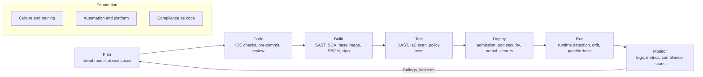

# DevSecOps Model (Red Hat-style, generic)

> **How to use:** Read this overview first, run the self-assessment (`maturity-self-assessment.csv`), pick gaps, then follow the 30/60/90 roadmap. Replace `<PLACEHOLDERS>`. This is a generic framework adapted from the widely described Red Hat approach (security embedded across the whole lifecycle). It is a recommended model for Contoso Ltd., not a statement of what is deployed anywhere. Numbers are examples.

## Principles

1. **Culture and people first.** Security is a shared outcome of dev, sec and ops; no "throw it over the wall".
2. **Automate everything repeatable.** Policies, scans and evidence are produced by pipelines, not by meetings.
3. **Shift left, but also shift right.** Catch issues early, and keep watching in production.
4. **Containers and Kubernetes are secured in three phases:** build, deploy, run.
5. **Protect the supply chain.** Know what you build from, prove what you built, verify what you deploy.
6. **Compliance as code.** Controls are expressed as testable rules with evidence.
7. **Continuous monitoring** feeds back into the backlog.

## Lifecycle

## Three container phases

| Phase | Question it answers | Controls file |
|-------|--------------------|---------------|
| Build | Is what we ship made from trusted parts and proven? | build-phase-controls.md |
| Deploy | Is only compliant workload admitted, isolated and given secrets safely? | deploy-phase-controls.md |
| Run | Do we detect drift and attacks, and do we patch by rebuilding? | run-phase-controls.md |

## Contents

| File | Purpose |
|------|---------|
| maturity-model.md | Four maturity levels per domain |
| maturity-self-assessment.csv | Scoring sheet (levels 1-4) |
| build-phase-controls.md | Base images, scanning, signing, SBOM, registry policy |
| deploy-phase-controls.md | Admission, pod security, network policy, secrets |
| run-phase-controls.md | Runtime detection, drift, patching and rebuild |
| kubernetes-openshift-hardening-checklist.csv | Cluster hardening checklist |
| [example-admission-policy.yaml](./example-admission-policy.yaml) | Generic Kyverno and native admission examples |
| [example-networkpolicy.yaml](./example-networkpolicy.yaml) | Default-deny and allow-list NetworkPolicies |
| [ansible-baseline-hardening.yml](./ansible-baseline-hardening.yml) | Generic Linux node baseline playbook |
| compliance-as-code-mapping.csv | CIS / ISO 27001 / NIST CSF 2.0 mapping |
| raci-dev-sec-ops.md | Responsibilities for dev, sec, ops |
| metrics-definitions.csv | DORA and security metrics |
| adoption-roadmap-30-60-90.md | Phased adoption plan |
| tool-mapping.md | Categories with open-source and Red Hat ecosystem examples |

Related: secure-dev-training, secure-sdlc, pipelines/security-gates.
